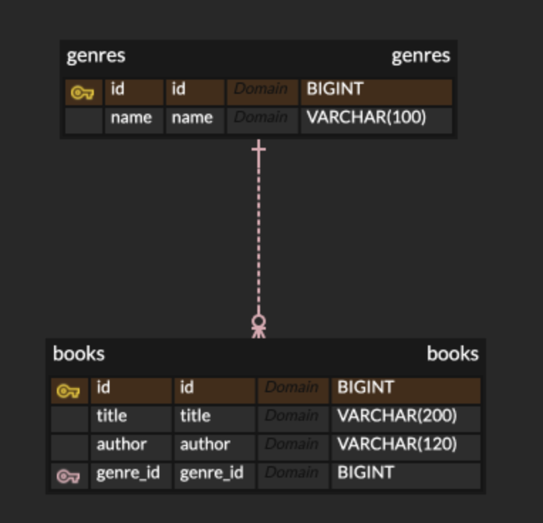

# 도서·장르 ERD

| 테이블 | 컬럼 |
|---|---|
| genres | id BIGINT PK·자동 증가, name VARCHAR(100) NOT NULL |
| books | id BIGINT PK·자동 증가, title VARCHAR(200) NOT NULL, author VARCHAR(120) NOT NULL, genre_id BIGINT NOT NULL FK |

`books.genre_id`는 `genres.id`를 참조합니다. 장르 하나에는 도서가 0권 이상 연결될 수 있고, 도서는 반드시 하나의 장르에 속합니다.

- `Genre.books`: `@OneToMany(mappedBy = "genre")`
- `Book.genre`: `@ManyToOne(fetch = FetchType.LAZY, optional = false)`
- 외래 키를 가진 `Book.genre`가 연관관계의 주인입니다.
- `@OrderBy("id ASC")`는 조회 정렬이며 별도 컬럼을 만들지 않습니다.

[MySQL 테이블 정의](schema.sql) · [Mermaid 관계 정의](schema.mmd)
