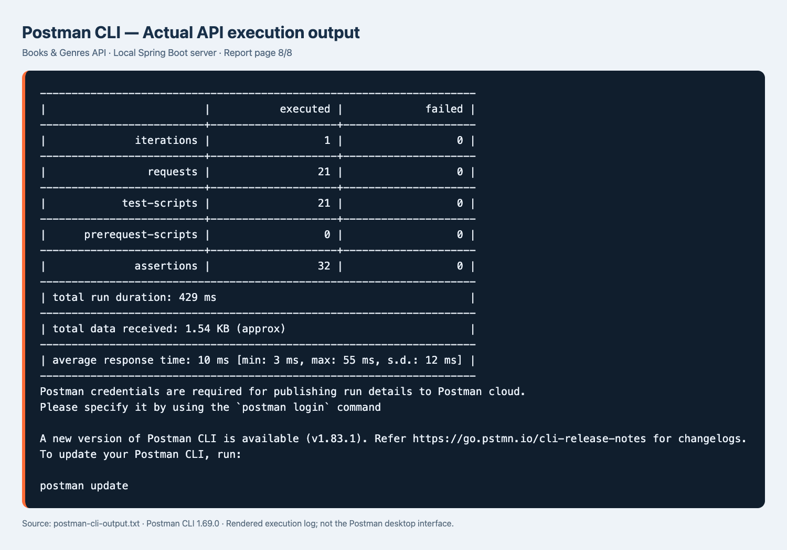

# Postman 실행 증빙

로컬 Spring Boot API에 Postman CLI 1.69.0으로 컬렉션을 실행했습니다. **요청 21개 / 검증 32개 / 실패 0개**입니다. 생성한 테스트 데이터는 컬렉션 마지막 단계에서 정리합니다.

- [Import 가능한 컬렉션](books-genres.postman_collection.json)
- [실제 CLI 원본 출력](postman-cli-output.txt)
- [전체 결과 HTML](postman-results.html)

아래 이미지는 원본 CLI 출력의 렌더링입니다. Postman 데스크톱 앱의 UI 캡처는 아닙니다. CLI 클라우드 게시에는 로그인이 필요하지만, 로컬 컬렉션 테스트는 정상 완료되었습니다.

| 이미지 | 포함된 요청 |
|---|---|
| [01](postman-results-01.png) | 장르 생성 2건, 전체 조회 |
| [02](postman-results-02.png) | 장르 단건 조회·수정, 도서 생성 |
| [03](postman-results-03.png) | 도서 전체·단건 조회, 장르별 도서 조회 |
| [04](postman-results-04.png) | 도서가 남은 장르 삭제409, 공백400, 없는 장르404 |
| [05](postman-results-05.png) | 장르 공백400, 없는 도서404, 도서 제목·장르 수정 |
| [06](postman-results-06.png) | 이전 장르 관계 해제, 도서 삭제, 삭제된 도서404 |
| [07](postman-results-07.png) | 두 장르 삭제, 삭제된 장르404 |
| [08](postman-results-08.png) | 전체 실행 요약 |

