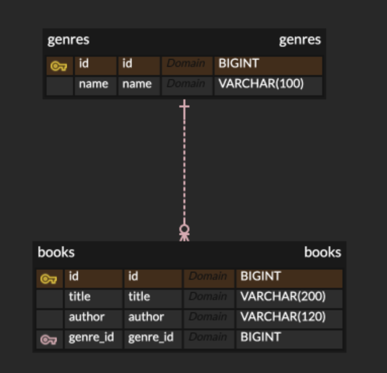

# 도서·장르 관리 API

도서와 장르를 관리하는 Spring Boot + Spring Data JPA REST API입니다. 하나의 장르는 여러 도서를 가질 수 있고, 도서는 반드시 하나의 장르에 속합니다.

## 실행

- Java 21
- Spring Boot 4.1.2 / Gradle Wrapper
- 기본 DB: H2 파일 DB (`Jpa/data/books`). 실행 환경에 별도 DB 설치가 필요하지 않습니다.

```bash
cd leesak/Jpa
./gradlew bootRun
```

기본 주소는 `http://localhost:8080`입니다. MySQL을 사용하려면 데이터베이스를 먼저 생성하고 환경변수와 `mysql` 프로필을 설정합니다.

```bash
export DB_URL='jdbc:mysql://localhost:3306/books?serverTimezone=Asia/Seoul&characterEncoding=UTF-8'
export DB_USER_NAME='사용자명'
export DB_PASSWORD='비밀번호'
./gradlew bootRun --args='--spring.profiles.active=mysql'
```

DB 계정 정보는 소스에 포함하지 않습니다. 기본 파일 DB는 재시작해도 데이터가 유지됩니다.

## 엔티티 관계



[ERD 및 테이블 정의](ERD/README.md)에서 관계와 컬럼을 확인할 수 있습니다.

- `Genre.books`: `@OneToMany(mappedBy = "genre")`
- `Book.genre`: `@ManyToOne(fetch = FetchType.LAZY)`
- `books.genre_id`: `genres.id`를 참조하는 필수 외래키
- 도서가 남아 있는 장르 삭제는 `409 Conflict`로 거절합니다. 도서를 먼저 삭제하거나 다른 장르로 변경해야 합니다.
- 응답 DTO를 사용하여 엔티티의 양방향 관계가 JSON 순환 참조로 이어지지 않도록 구성했습니다.

## API

| 기능 | 메서드 | 경로 | 성공 응답 |
|---|---|---|---|
| 장르 생성 | POST | `/genres` | 201 |
| 장르 전체 조회 | GET | `/genres` | 200 |
| 장르 단건 조회 | GET | `/genres/{id}` | 200 |
| 장르 부분 수정 | PATCH | `/genres/{id}` | 200 |
| 장르 삭제 | DELETE | `/genres/{id}` | 204 |
| 도서 생성 | POST | `/books` | 201 |
| 도서 전체 조회 | GET | `/books` | 200 |
| 도서 단건 조회 | GET | `/books/{id}` | 200 |
| 도서 부분 수정 | PATCH | `/books/{id}` | 200 |
| 도서 삭제 | DELETE | `/books/{id}` | 204 |

장르 생성·수정 요청:

```json
{"name": "문학"}
```

도서 생성 요청:

```json
{"title": "소년이 온다", "author": "한강", "genreId": 1}
```

도서 부분 수정은 변경할 필드만 전송합니다. 예를 들어 아래 요청은 저자를 유지하고 제목·장르를 변경합니다.

```json
{"title": "채식주의자", "genreId": 2}
```

장르 응답에는 `id`, `name`, `books`(도서의 `id`, `title`, `author` 목록)가 포함됩니다. 도서 응답에는 `id`, `title`, `author`, `genreId`, `genreName`이 포함됩니다.

잘못된 필수 입력이나 공백 문자열은 `400 Bad Request`, 존재하지 않는 도서·장르는 `404 Not Found`, 도서가 남아 있는 장르 삭제는 `409 Conflict`로 처리합니다.

## Postman 테스트

`Postman/books-genres.postman_collection.json`을 Postman에서 Import한 뒤 실행합니다. 컬렉션 변수 `baseUrl`의 기본값은 `http://localhost:8080`입니다. 실행 중 생성된 ID를 변수로 저장하므로 DB의 자동 증가 시작값에 의존하지 않습니다.

Postman CLI로 동일한 컬렉션을 실행할 수 있습니다.

```bash
postman collection run Postman/books-genres.postman_collection.json --no-report-events
```

테스트는 장르·도서 생성/조회/수정/삭제, 장르별 도서 조회, 장르 이동, 부분 수정 시 필드 유지, 입력 오류(400), 없는 리소스(404), 도서가 남은 장르 삭제(409)를 검사합니다. 마지막에는 테스트에서 생성한 데이터를 삭제합니다.

실제 Postman 앱 캡처 15장과 실제 CLI 출력으로 만든 추가 결과 이미지 3장을 [기능별 결과](Postman/README.md)에 첨부했습니다. 수동 캡처에서 변경한 데이터와 일부 assertion 예상값의 차이도 해당 문서에 설명했습니다.

2026년 11월 2일 13:09 (KST), 제출 JAR를 별도 H2 메모리 DB와 포트 `18082`에서 실행하여 요청 21개·검증 32개가 모두 통과했습니다. [전체 CLI 실행 기록](Postman/postman-cli-output.txt)에는 모든 API의 실제 응답과 삭제 후 조회 검증도 포함됩니다.


## SQL 실행 로그

SQL 콘솔 캡처 3장과 전체 컬렉션 재검증 중 발생한 실제 SQL 30개·바인딩 값을 [SQL 기능별 설명](SQL/README.md)과 [전체 SQL 실행 로그](SQL/execution.log)에 첨부했습니다. 장르·도서 CRUD 10개 기능과 오류 응답의 SQL을 확인할 수 있습니다.

## 자동화 테스트

```bash
cd Jpa
./gradlew test
```

Java 21에서 `./gradlew test bootJar`를 실행하여 HTTP 통합 테스트 5개가 모두 통과했고 JAR 빌드도 성공했습니다(2026년 11월 2일 KST).

## 제출 파일

```text
leesak/
├── Jpa/       # Spring Boot 소스, Gradle Wrapper, 통합 테스트
├── Postman/   # 실제 앱 캡처 15장, CLI 결과 이미지 3장, 컬렉션·전체 로그
├── ERD/       # ERD 이미지 1장, SQL·Mermaid 테이블 정의
└── SQL/       # 콘솔 캡처 3장, 기능별 설명, 실제 SQL·바인딩 로그
```
